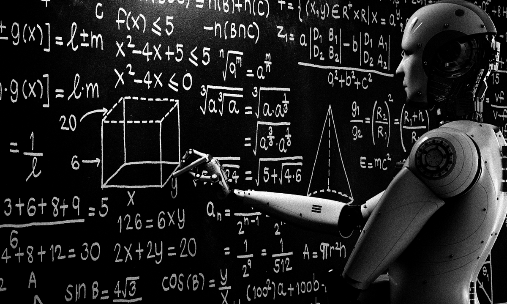

## Le métier

En quelques mois tout a changé. J'ai beaucoup entendu parler de **l'état de sidération**, et c'est probablement ce sentiment qui prédomine dans la communauté des mathématiciennes et mathématiciens. En quelques mois, la machine a écrasé des problèmes ouverts depuis des années, voire des décennies. Ces problèmes sont le carburant des mathématiques. Ils vous font vous coucher tard, vous lever tôt, vous plongent dans des phases d'un enthousiasme fou, souvent réduits à des résultats bien plus modestes. Dans le processus, c'est tout un univers qui s'ouvre sur notre tableau ou nos cahiers, tout un langage et une réflexion qui se construisent. 

## Actualité

Il est aujourd'hui clair que la machine nous écrase. Les 721 récentes prépublications d'[openai](https://github.com/openai/math) en attestent. Elle nous écrasera sans doute plus encore. Elle interpole la connaissance mieux que nous, comprend parfaitement la littérature, explore mille directions en une fraction de seconde.

De nature optimiste, je garde espoir: certaines idées seront encore nouvelles et originales. L'IA aurait-elle inventé la transformée de Fourier sans Joseph Fourier ? L'IA pourrait-elle découvrir les nombres transfinis sans Georg Cantor ? Les idées vraiment nouvelles se feront rares, cela semble entendu, mais disparaîtront-elles ? Je fais le choix d'en douter.

## Quelle attitude adopter ?

Plusieurs attitudes opposées se proposent à nous. En premier lieu, **le déni**. C'est une attitude respectable. Elle consiste à continuer son chemin sans en dévier. Le risque est de se retrouver isolé dans une bulle. Quand toute sa communauté scientifique proche se met à débroussailler des pans entiers de son propre domaine d'expertise, comment réagir ? 
Il se peut même qu’un étudiant de licence génère des centaines de pages avec l’IA. Si nous les ignorons, nous risquons de persister dans des directions infructueuses. Il existe tout un mouvement de la "[slow science](https://www.slow-science.com)" qui prône cette approche de lenteur, qui seule, à mon sens, permet une lente digestion humaine de la connaissance scientifique.

Une seconde approche serait celle d'un **déni par principe**. Dans cette idée, le refus est de l'ordre du refus de la compromission. Il est de l'ordre des valeurs. Il ne faut pas chercher longtemps pour comprendre. Rien ne va dans l'état actuel des choses. Les systèmes d'IA détruisent notre environnement (eau, sol, énergie, terres rares,...), ils sont payants, maintenus et contrôlés par les intérêts privés de puissance hostiles. Enfin, ils brisent notre pacte d'égalité : quand seulement quelques mathématiciens aux USA ont accès à la meilleure des IA, ils ont entre leurs mains un pouvoir de création (et de destruction) immense. La compétition avec nos métriques actuelles est alors totalement biaisée. Nous entrons dans une ère de perte de sens.

Une troisième approche, et j'en fais partie, est celle de l'**utilisation amateure**. Au-delà de la correction de texte, je questionne l'IA pour reformuler une démonstration, générer une illustration, proposer des pistes nouvelles, critiquer mes articles en cours de rédaction. Le projet scientifique, les idées principales, la structuration du texte restent de mon ressort. L'IA est aussi un exceptionnel outil pour améliorer mon code. L'IA corrige mes packages, rend le code plus efficient, et écrit la documentation avec une efficacité remarquable. Elle m'aide aussi dans la réalisation des simulations pour mes articles. Cette approche comporte aussi ses risques, en particulier celui d'une perte d'autonomie intellectuelle. L'IA est persuasive, il est difficile de lui résister. Elle peut nous mener à un assèchement de la créativité. 

Enfin, la dernière attitude serait celle d'un **Stakhanovisme des mathématiques**. Un collègue de l’Université de Chicago a [produit 257 articles](https://chicagomaroon.com/53994/news/tenured-booth-professor-criticized-for-publishing-ai-slop-research-papers/) scientifiques en seulement neuf mois. Ils ont depuis été retirés. Je ne connais personnellement aucun collègue qui approuverait une telle approche. 
 

## Human mathematics

En ce qui me concerne, j'ai un programme de recherche en cours autour des *change points* avec un certain nombre de publications pré-AI à finaliser. Pour ces articles "AI-free", je sais où aller et quoi faire. La suite me paraît plus incertaine. 

Je ne sais pas encore quand, comment et à quelle dose introduire l’IA dans ma recherche : dès la phase initiale (au risque de m’y perdre indéfiniment), pendant la rédaction (au risque de devoir abandonner un travail que l’IA jugerait insignifiant) ou en phase finale (pour augmenter mes chances de publication).

Nous sommes assez nombreux à suspecter une utilisation de l'IA dans le processus de review. Cela rend (ou rendra bientôt) un passage par l’IA avant toute soumission à une revue presque incontournable.

J'ai signé deux des trois engagements proposés par [l'association des mathématiques humaines](https://www.ahmath.org)

1. **Les membres s’engagent à ne pas collaborer avec des entreprises commerciales d’intelligence artificielle**, que ce soit en leur fournissant un travail technique, des connaissances mathématiques, des services de conseil ou de la publicité.

2. **Les membres s’engagent à ne pas publier de textes mathématiques générés par des modèles d’intelligence artificielle** (notamment des articles de recherche, des comptes rendus critiques, des rapports d’évaluation, des notes de cours, des supports pédagogiques et des livres).

Le troisième engagement concerne l'utilisation de l'IA dans la recherche. Au regard de ma pratique actuelle, je ne l'ai pas signé.

3. **Les membres du collectif « sans IA » (AI-free caucus) s’engagent à ne pas utiliser de modèles d’intelligence artificielle dans le cadre de leurs activités de recherche.** Ils mènent les activités fondamentales de la recherche mathématique, telles que la recherche de démonstrations, l’exploration d’exemples et la formulation de questions de recherche, sans solliciter d’outils d’intelligence artificielle.

Quel que soit votre usage de l'IA, je vous encourage à signer des engagements, participer à des collectifs et des discussions, adhérer à des associations mathématiques. Une organisation collective la plus large possible est essentielle, elle doit dépasser le cadre des discussions devant la machine à café. 

## Dessiner un futur enviable: rêver grand

Le constat dressé ci-dessus est désespérant à bien des égards. Une époque de très grande incertitude débute et une longue phase d'adaptation s'annonce pour la communauté mathématique. Elle commence par un **climat de suspicion généralisée**, où les résultats écrits perdent de leur valeur car suspect d'être détaché d'une compréhension humaine fine et profonde.

Dans un prochain billet de blog, j'essayerai de présenter des pistes de réflexion à long terme. Principalement, j'envisage l'existence et la création d'une **machine mathématique universelle** qui mesurerait le progrès des connaissances mathématiques, découplé de sa compréhension humaine.

