

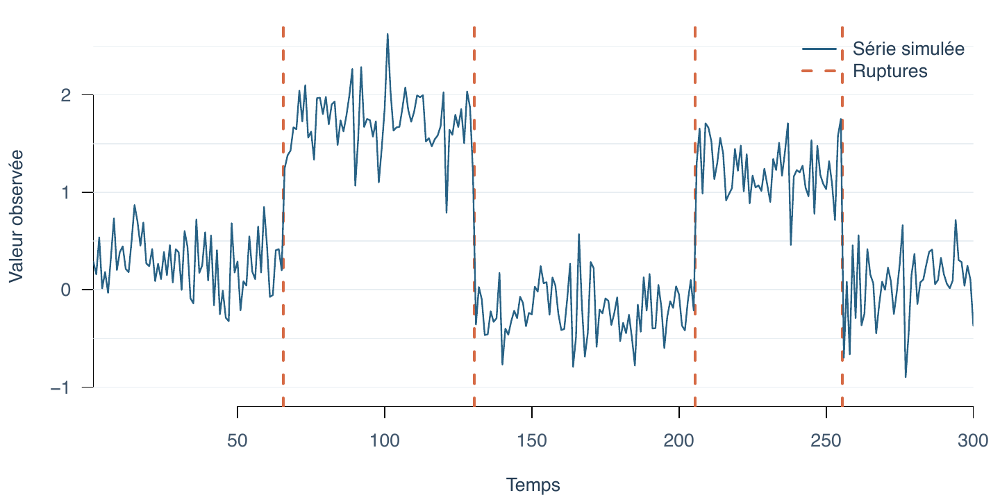

Cet billet de blog introduit mon activité de recherche principale depuis quelques années, à savoir **l'analyse des séries temporelles par la détection de ruptures**. Nous allons très progressivement motiver les enjeux, jusqu'à présenter la méthode par **programmation dynamique** que j'apprécie tout particulièrement. Et je vous dirais pourquoi!

## Des exemples à foison

Une série temporelle n'est rien de plus que des données ordonnées dans le temps, comme des mesures de température chaque jour, le nombre de visiteurs sur un site web chaque heure, ou encore le cours d'une action chaque minute. On considère un pas de temps régulier et rendons les unités de mesure implicites, comme il est d'usage en mathématiques. On obtient ainsi une suite de valeurs $y_1, y_2, \dots, y_T$, où $T$ est la longueur de la série, et $y_t$ représente la valeur observée au temps $t$, ici un entier. C'est cette suite de $y$ que l'on nomme **série temporelle**.

L'objectif de la détection de ruptures est d'**identifier les moments** où le comportement de la série **change de manière significative**. 

Ce type de comportement n'est pas universel. Il peut y avoir des séries temporelles au comportement plutôt régulier, par exemple les températures heures par heure sont moins adaptées à ce genre d'analyse. À l'inverse, le cours d'une action peut vivre un crack boursier et subir des changements brutaux que l'on cherche à détecter.

Quelques exemples valent mieux que ce long discours. Les explications sont délibérément très succinctes. Le lecteur se concentrera sur **l'aspect visuel**. J'ai collecté une série d'exemples dans la littérature récente. 

::: {.example-row}
::: {.example-text}
**Réchauffement climatique.** Quatre séries d’anomalies de température mondiale sont ajustées par des fonctions linéaires par morceaux, continues ou discontinues. Les ajustements montrent un changement du rythme de réchauffement autour des années 1970, mais aucun changement ultérieur ; la puissance limitée du test ne permet toutefois pas d’exclure une accélération récente ([Beaulieu et al., 2024](#ref-beaulieu2024surge)).
:::

::: {.example-image}
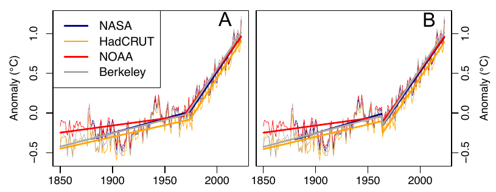{fig-alt="Anomalies de température mondiale et ajustements linéaires par morceaux"}
:::
:::

::: {.example-row .image-left}
::: {.example-text}
**Activité et capteurs mobiles.** Un smartphone peut aider à reconnaître une activité à partir de ses capteurs. La figure montre une composante de l’accéléromètre, les frontières estimées en pointillés et les activités annotées en couleur. La segmentation utilise conjointement les trois axes de l’accéléromètre et les trois axes du gyroscope ([Li et al., 2019](#ref-li2019wearable)).
:::

::: {.example-image}
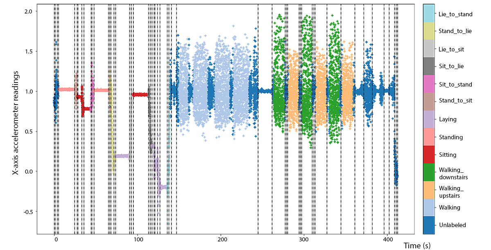{fig-alt="Mesure d’accéléromètre, activités annotées et frontières estimées"}
:::
:::

::: {.example-row}
::: {.example-text}
**Comportement animal.** Le trajet d’un zèbre est découpé en phases à partir de sa vitesse et de ses changements de direction. Les segments sont ensuite regroupés en modes de comportement : la figure montre le trajet, le choix du nombre de segments et de groupes, puis leur répartition au cours du temps ([Patin et al., 2019](#ref-patin2020animal)).
:::

::: {.example-image}
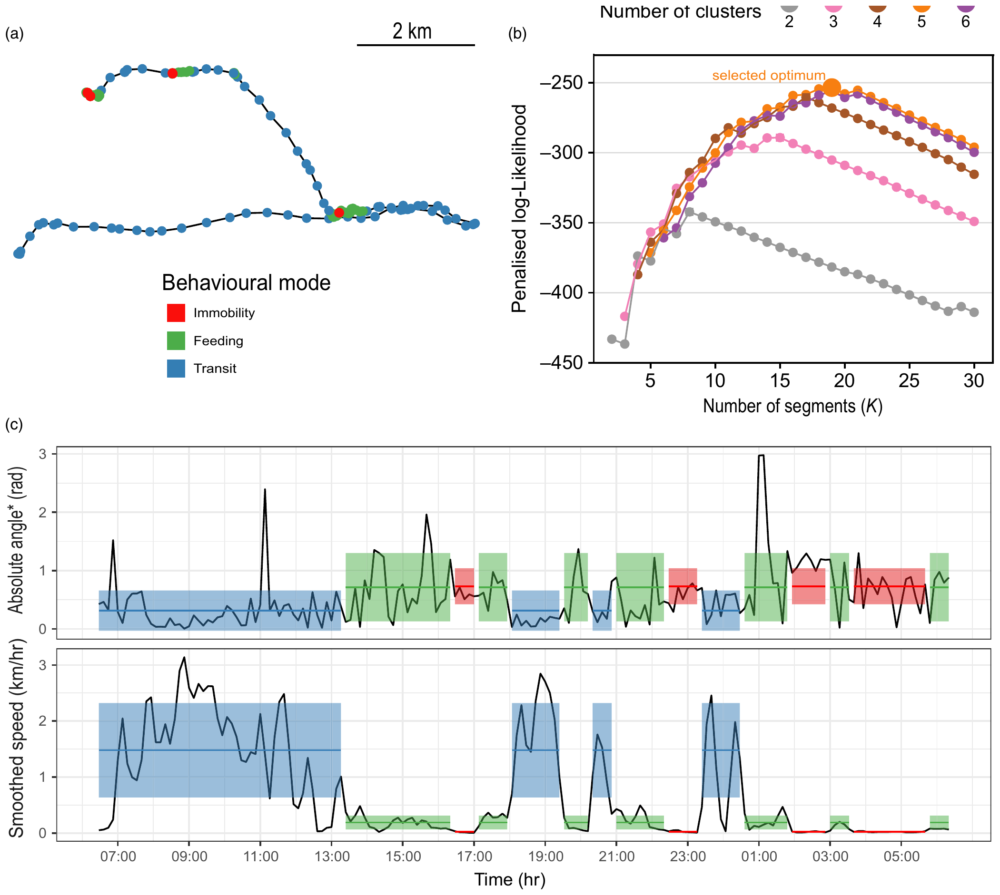{fig-alt="Trajet d’un zèbre et segmentation de sa vitesse et de ses changements de direction"}
:::
:::

::: {.example-row .image-left}
::: {.example-text}
**Moteur flagellaire bactérien.** La position angulaire du moteur est représentée en noir. Deux ajustements en rouge la décrivent par morceaux constants ou par morceaux linéaires continus. La méthode CPOP détecte les changements de pente à l’aide d’une pénalité sur leur nombre ([Fearnhead et al., 2019](#ref-fearnhead2019detecting)).
:::

::: {.example-image}
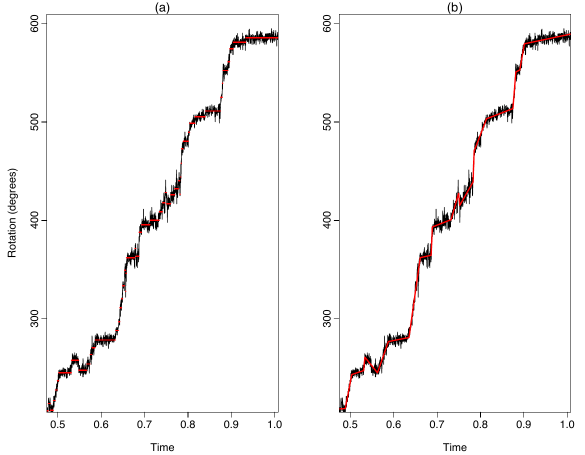{fig-alt="Position angulaire du moteur et ajustements par morceaux"}
:::
:::

::: {.example-row}
::: {.example-text}
**Transit d’exoplanètes.** La courbe de lumière de Kepler 1132 est repliée selon trois périodes candidates. La baisse de luminosité visible au centre, pour une période proche de 62,9 jours, est compatible avec un transit planétaire. La méthode CAPA détecte de courtes anomalies collectives tout en permettant des valeurs aberrantes isolées ([Fisch et al., 2022](#ref-fisch2022capa)).
:::

::: {.example-image}
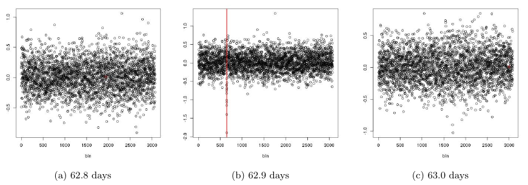{fig-alt="Courbes de lumière de Kepler 1132 pour trois périodes candidates"}
:::
:::

::: {.example-row .image-left}
::: {.example-text}
**Séismes.** Près de Parkfield, en Californie, plusieurs capteurs enregistrent les mouvements du sol. La ligne pleine indique l’heure du séisme et les pointillés les changements estimés. La méthode NP-MOJO détecte des changements de distribution et de dépendance temporelle dans ces signaux multivariés ([McGonigle et Cho, 2025](#ref-mcgonigle2025npmojo)).
:::

::: {.example-image}
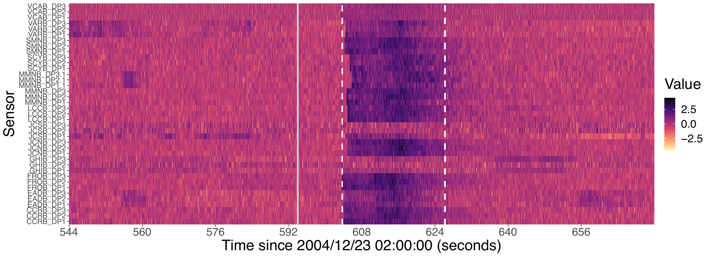{fig-alt="Mesures sismiques et changements estimés près de Parkfield"}
:::
:::

::: {.example-row}
::: {.example-text}
**Acoustique sous-marine.** Ce spectrogramme représente un enregistrement sous-marin ; les lignes verticales indiquent les ruptures estimées dans la puissance du signal par une segmentation binaire bayésienne ([Hubert et al., 2019](#ref-hubert2019acoustic)).
:::

::: {.example-image}
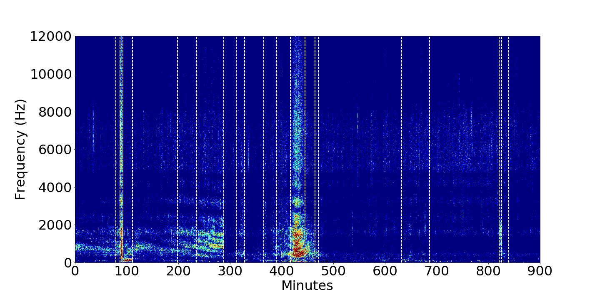{fig-alt="Spectrogramme sous-marin avec ruptures estimées"}
:::
:::

::: {.example-row .image-left}
::: {.example-text}
**Électrocardiogramme.** Un électrocardiogramme peut être découpé en états correspondant aux différentes formes de l’onde. La segmentation en bleu respecte les successions d’états permises par un graphe ; les pics R détectés apparaissent en rouge ([Fotoohinasab et al., 2020](#ref-fotoohinasab2020ecg)).
:::

::: {.example-image}
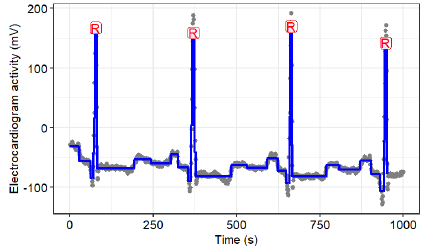{fig-alt="Électrocardiogramme segmenté et pics R détectés"}
:::
:::

::: {.example-row}
::: {.example-text}
**Génomique.** Dans les données ChIP-seq, la couverture des lectures révèle des régions associées à des marques d’histones. Les niveaux ajustés sont en bleu et les ruptures en rouge. En bas, une contrainte d’alternance entre hausses et baisses permet d’identifier les pics ([Liehrmann et al., 2021](#ref-liehrmann2021chipseq)).
:::

::: {.example-image}
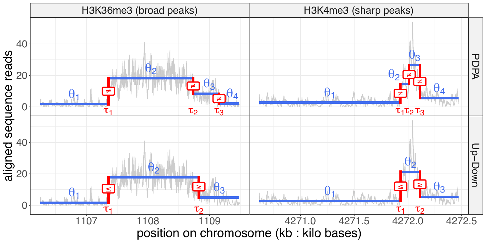{fig-alt="Couverture ChIP-seq, niveaux ajustés et pics détectés"}
:::
:::

::: {.example-row .image-left}
::: {.example-text}
**Volatilité financière.** Les rendements quotidiens logarithmiques du S&P 500 de juillet 2010 à octobre 2019 sont analysés à la recherche de changements de variance. Trois méthodes sont comparées : segmentation binaire avec CUSUM, segmentation binaire par rapport de vraisemblance et PELT. Les lignes rouges indiquent les changements significatifs au seuil de 5 % après correction pour les tests multiples ; les autres sont en gris ([Carrington et Fearnhead, 2026](#ref-carrington2026variance)).
:::

::: {.example-image}
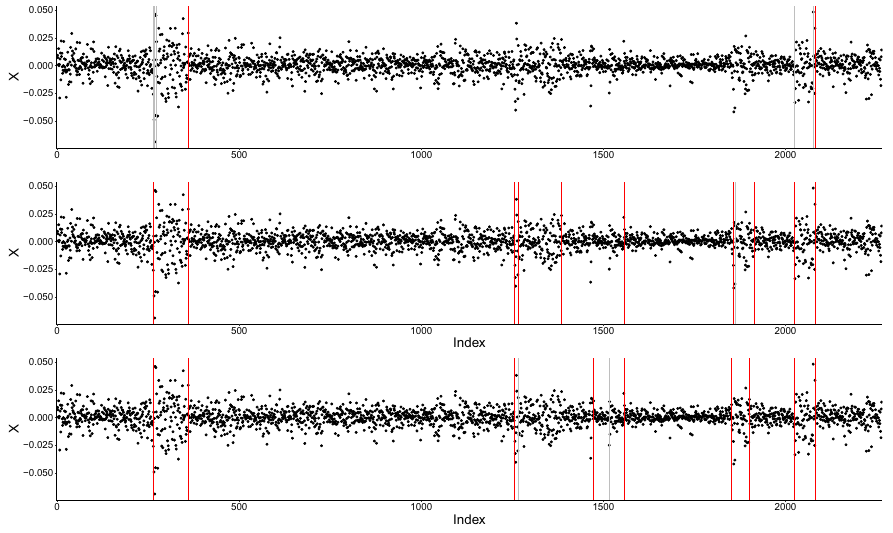{fig-alt="Rendements du S&P 500 et changements de variance estimés par trois méthodes"}
:::
:::

## Segmenter les séries temporelles

En termes simples, l'objectif de la détection de ruptures, aussi appelée segmentation, est de diviser la série temporelle en segments successifs homogènes **de manière automatique**. Les segments sont séparés par des ruptures, représentées par les lignes verticales dans la plupart des exemples ci-dessus. Mais que signifie « homogène » ? Cela dépendra du modèle choisi : nous allons commencer par un modèle dans lequel la moyenne reste constante à l'intérieur de chaque segment.

Pour décrire une segmentation de $y_1,\ldots,y_T$, notons ses frontières :

\begin{equation}
0=\tau_0<\tau_1<\cdots<\tau_K=T.
\end{equation}

Il y a $K$ segments et $K-1$ ruptures internes, $\tau_1,\ldots,\tau_{K-1}$. La rupture $\tau_k$ est le dernier indice du segment $k$ : le segment suivant commence donc à $\tau_k+1$. Plus généralement, pour $0\leq a<b\leq T$, nous noterons $y_{a..b}=(y_{a+1},\ldots,y_b)$.

Dans notre modèle, chaque observation est la somme d'une moyenne et d'un bruit :

\begin{equation}
Y_t=\mu_t+\sigma\varepsilon_t,\qquad
\varepsilon_t\overset{\mathrm{i.i.d.}}{\sim}\mathcal N(0,1),
\qquad t=1,\ldots,T.
\end{equation}

Ici, $Y_t$ désigne l'observation aléatoire dont $y_t$ est la valeur observée, $\sigma>0$ mesure l'amplitude du bruit et $\mu_t=\theta_k$ pour $\tau_{k-1}<t\leq\tau_k$. Autrement dit, la moyenne $\theta_k$ reste constante sur le segment $k$, mais change d'un segment à l'autre. Notre but est de **déterminer à la fois** le **nombre** de segments et **leurs frontières** à partir des données.

Pour mesurer l'homogénéité d'un segment $y_{a..b}$, on utilise la somme des carrés des écarts à sa moyenne :

\begin{equation}
\mathcal C(y_{a..b})=\sum_{t=a+1}^{b}(y_t-\bar y_{a..b})^2,
\qquad
\bar y_{a..b}=\frac{1}{b-a}\sum_{t=a+1}^{b}y_t.
\end{equation}

Plus ce coût est petit, mieux une moyenne constante décrit le segment. Si l'on minimise uniquement la somme de ces coûts, on peut attribuer un segment à chaque observation et obtenir un coût nul. Pour éviter ce découpage excessif, on ajoute un prix $\beta>0$ pour chaque segment. On cherche alors une segmentation qui minimise le critère avec prix, on l'appelle communément un **critère pénalisé** ([Yao, 1988](#ref-yao1988estimating)) :

\begin{equation}
\min_{\tau}\left\{
\sum_{k=1}^{K(\tau)}\mathcal C(y_{\tau_{k-1}..\tau_k})
+\beta K(\tau)
\right\}.
\end{equation}

Le minimum porte sur toutes les segmentations de la série et $K(\tau)$ est leur nombre de segments. Une pénalité plus forte rend les segments supplémentaires plus coûteux ; une pénalité plus faible favorise les sur-découpages. 

Il reste une difficulté : entre deux observations, on peut choisir de placer ou non une rupture. Pour $T$ observations, cela donne $2^{T-1}$ segmentations possibles ! Avec seulement $T=100$, il faudrait déjà en examiner plus de $6\times 10^{29}$. Une recherche exhaustive devient vite impossible : avec $T = 100$, c’est à peu près autant que le nombre de molécules d’eau dans 18 tonnes d’eau...

Voici neuf segmentations possible de la série simulée en début de billet. Les pointillés indiquent les ruptures estimées ; les panneaux sont disposés dans un ordre aléatoire. Cette série contient 300 observations, donc $2^{299}$ segmentations possibles.

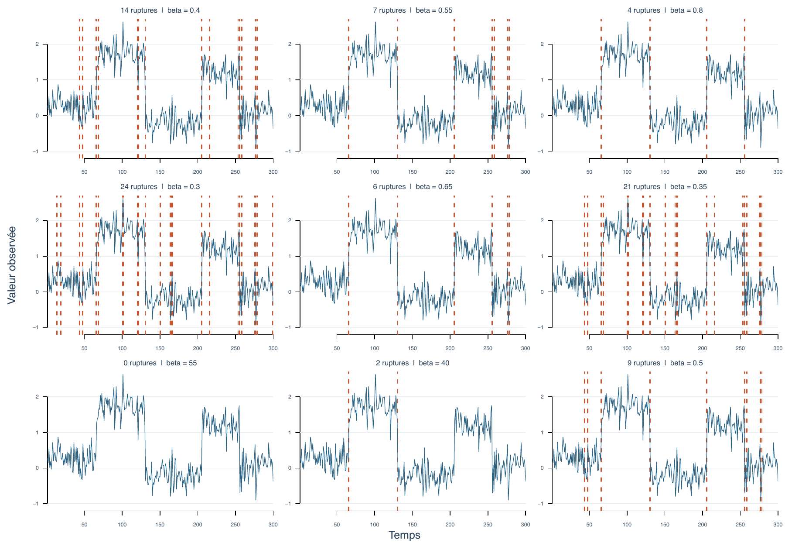{fig-alt="Grille de neuf graphiques montrant la même série temporelle et neuf ensembles de ruptures estimées par PELT."}

## La programmation dynamique

La **programmation dynamique** permet de résoudre exactement notre problème sans énumérer toutes les segmentations. C'est ici toute sa magie!

Son principe itératif remonte aux travaux de Richard Bellman ([Bellman, 1954](#ref-bellman1954some)) ; Walter D. Fisher l'a notamment appliqué à un problème de regroupement en segments homogènes ([Fisher, 1958](#ref-fisher1958grouping)).

L'idée est de faire plus que nécessaire... à savoir trouver non seulement le coût $Q_T$, mais aussi $Q_1$, $Q_2$, $\ldots$, $Q_{T-1}$. Ce travail supplémentaire permet en fait une réduction importante. Au lieu de trouver la segmentation correspondant pour chacun des coût optimaux précédents, nous allons **seulement nous souvenir de la position de la dernière rupture du dernier segment**, cela pour chacun des coûts $Q_1,\ldots,Q_T$. Tout cela est assemblé dans la séquence d'opération suivante.

Pour $t\geq 1$, notons $\mathcal S_t$ l'ensemble des segmentations de $y_{0..t}$ et $Q_t$ le coût optimal sur cet ensemble. En séparant le dernier segment, dont la frontière précédente est $s=\tau_{K(\tau)-1}$, on obtient :

\begin{align*}
Q_t
&= \min_{{\color{red}\tau}\in\mathcal S_t}
   \left[
   \sum_{k=1}^{K({\color{red}\tau})}
   \bigl\{{\color{blue}\mathcal C}
   (y_{{\color{red}\tau_{k-1}}..{\color{red}\tau_k}})+\beta\bigr\}
   \right]\\
&= \min_{{\color{red}\tau}\in\mathcal S_t}
   \left[
   \sum_{k=1}^{K({\color{red}\tau})-1}
   \bigl\{{\color{blue}\mathcal C}
   (y_{{\color{red}\tau_{k-1}}..{\color{red}\tau_k}})+\beta\bigr\}
   +{\color{blue}\mathcal C}
   (y_{{\color{orange}\tau_{K({\color{red}\tau})-1}}..{\color{red}t}})+\beta
   \right]\\
&= \min_{{\color{orange}s}\in\{0,\ldots,t-1\}}
   \Bigl\{Q_{{\color{orange}s}}
   +{\color{blue}\mathcal C}(y_{{\color{orange}s}..t})+\beta\Bigr\}.
\end{align*}

La dernière égalité utilise le meilleur coût $Q_s$ avant la dernière frontière $s$, avec $Q_0=0$ pour la série vide.

Il suffit donc d'essayer chaque frontière possible $s$ pour le dernier segment:

::: {.equationbox}
\begin{equation}
\label{eq:programmation-dynamique}
Q_t=\min_{0\leq s<t}\left\{
Q_s+\mathcal C(y_{s..t})+\beta
\right\},\qquad t=1,\ldots,T.
\end{equation}
:::

Pourquoi cela fonctionne-t-il ? Si une segmentation optimale jusqu'à $t$ utilise $s$ comme dernière frontière, alors sa partie jusqu'à $s$ doit elle aussi être optimale : sinon, on pourrait la remplacer par une meilleure segmentation et diminuer le coût total. On calcule ainsi successivement $Q_1,Q_2,\ldots,Q_T$. À chaque étape, seules les $t$ positions possibles de la dernière frontière sont examinées. Cette méthode est appelée **Optimal Partitioning**.

La valeur $Q_T$ donne le meilleur coût, **mais pas encore les positions** des ruptures. Pour les retrouver, on enregistre à chaque étape une frontière $s_t^*$ qui atteint le minimum. On part ensuite de $t=T$ et on remonte : $s_T^*$ est la frontière qui précède le dernier segment, puis $s_{s_T^*}^*$ celle qui précède le segment précédent, et ainsi de suite jusqu'à $0$. Notons que s'il y a plusieurs minima, en choisir un à chaque étape permet de reconstruire une segmentation optimale ; d'autres segmentations peuvent avoir le même coût. On appelle cette étape le **backtracking** en bon français.

La programmation dynamique en repose sur ces principes : 

- un problème est séquentiellement résolu en considérant ses sous-problèmes qui grandissent itérativement en ajoutant des données (c'est le passage **forward**); 
- pendant ce processus, **on enregistre une information** plus simple (la dernière position de rupture et non pas toute la partition);
- une fois le calcul terminé, on peut reconstruire la solution optimale en remontant ces informations (c'est le passage **backward**).

Combien de calculs faut-il ? La récurrence examine $1+2+\cdots+T=T(T+1)/2$ frontières candidates : sa complexité est donc en $O(T^2)$, **à condition de calculer chaque coût de segment en temps constant**. Dans notre exemple gaussien, cela est possible grâce aux sommes cumulées des observations et de leurs carrés. En posant $S_t=\sum_{i=1}^{t}y_i$ et $R_t=\sum_{i=1}^{t}y_i^2$, avec $S_0=R_0=0$, on obtient :

::: {.equationbox}
\begin{equation}
\mathcal C(y_{a..b})=(R_b-R_a)-\frac{(S_b-S_a)^2}{b-a}.
\end{equation}
:::

Après un calcul initial (linéaire) de ces sommes cumulées, chaque segment est évalué à partir de quelques opérations, quelle que soit sa longueur. La programmation dynamique transforme ainsi une recherche parmi un **nombre exponentiel** de segmentations en un **calcul quadratique**. 

## Pourquoi on est content ?

J'avais promis de révéler pourquoi la programmation dynamique est, à mon sens, si satisfaisante dans le contexte de la détection de ruptures. 

- La programmation dynamique permet une analyse séquentielle des données. Une nouvelle donnée, $y_{T+1}$, s'intègre facilement, sans avoir à reprendre tous les calculs précédents. C'est une propriété **séquentielle** assez rare en machine learning;

- La programmation dynamique est une méthode dite **exacte**, dans le sens où elle retourne la (ou l'une des) segmentation(s) optimale(s). Beaucoup d'autres approches sont approximatives, avec le bénéfice d'une vitesse améliorée (en $O(n \log(n))$ généralement);

- La programmation dynamique permet d'incorporer facilement des **contraintes supplémentaires** sur les segments, comme la continuité. 

## Ce n'est que le début du voyage...

Chacun des points suivants sera développé dans de futurs billets. Ils correspondent à des extensions ou améliorations de l'approche par programmation dynamique que je développe dans mon activité de recherche.

1) Des méthodes d'**élagage** peuvent accélérer le calcul de la meilleure segmentation en écartant certaines frontières candidates sans perdre l'optimalité. L'accélération des calculs est alors fulgurante!

2) Certaines des figures présentées ci-dessus ne correspondent pas au modèle gaussien simple détaillé ici. Par exemple les cas du moteur flagellaire bactérien et du réchauffement climatique sont des cas où le modèle est linéaire par morceaux avec contrainte de continuité. On discutera donc de ces **modèles avec contraintes**;

3) Les données elles-même peuvent habiter un espace particulier, par exemple être contraintes à des points sur une sphère. Dans ce cas, l'astuce du calcul des coûts $C(y_{a..b})$ en temps constant n'est plus possible. On adaptera nos stratégies de détection de ruptures à ces **espaces non-Euclidiens**;

4) Enfin, nous remettrons en cause le choix du critère pénalisé lui-même. Une recherche de la meilleure segmentation peut être guidée par d'autres principes, par exemple en effectuant une recherche dans un **ordre lexicographique**.

Je développerai ces quatres points initialement dans les semaines et mois qui viennent. Je me m'interdis pas d'autres digressions sur le sujet, soyez prêts ! &#128522;

## Références

::: {#refs}
:::
