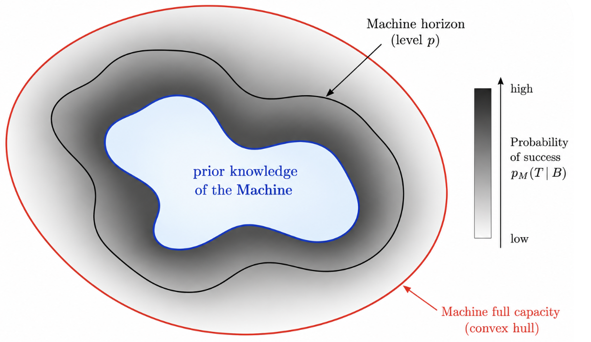
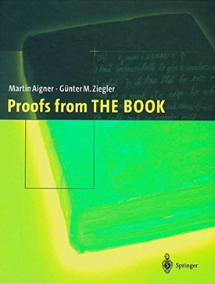

*Ce billet présente certaines des idées de l'article [On AI and Progress in Mathematics: Dreaming a Mathematical Universal Machine](https://arxiv.org/abs/2610.35263) (arXiv:2610.35263). C'est une réflexion personnelle sur l'avenir des mathématiques face à l'IA.*

Dans [le billet précédent](../2026-10-IAchanges/index.qmd), j'évoquais l'idée d'une machine mathématique universelle. Voici de quoi il s'agit.

Je pars d'un constat : les systèmes d'IA prouvent et vérifient désormais des résultats mathématiques mieux que les meilleurs mathématiciens. Ma proposition est de **découpler en partie l'avancement de la compréhension humaine de la mesure du progrès mathématique** : protéger la première, et se doter de nouveaux outils pour mesurer et organiser le second. Les publications serviraient avant tout à aider les humains à comprendre les mathématiques ; la mesure du progrès serait confiée à une **Machine Mathématique Universelle** (MUM), une infrastructure d'IA partagée par toute la communauté.

## De la montagne à la mine

Les mathématiciens décrivent volontiers leur recherche par la métaphore de l'ascension d'une montagne : au prix d'un immense effort solitaire, on atteint un sommet d'où l'on contemple un vaste paysage de vérités inexplorées. Comme l'a suggéré récemment Terence Tao, nous assistons peut-être à la fin de l'ère romantique des mathématiques, celle des héros solitaires.

**De la montagne, nous descendons dans la mine** : un paysage industriel, peuplé de machines, de découvertes inattendues et d'innovations disruptives. Ce n'est qu'une métaphore, mais elle permet de poser clairement le problème.

## La mine et le mineur

Dans ce nouveau monde, **la mine est l'espace des vérités mathématiques**. Les résultats sont des diamants cachés dans la roche, et les preuves sont les galeries qui y mènent. Le système d'IA mathématique est le **mineur** : il navigue dans cet espace en prenant ses propres décisions, avec une certaine autonomie, pour mener à bien la tâche qu'on lui confie.

Le mineur est composé de trois éléments :

1. **Des cartes** menant aux diamants déjà connus : articles de recherche, bases de résultats démontrés, définitions, concepts, graphes de dépendances entre théorèmes. Il peut s'y référer à tout moment pour améliorer sa recherche.
2. **Des outils** externes : Lean pour la vérification formelle, Python et le calcul formel pour l'expérimentation. Ils l'aident à explorer, vérifier, tester et s'orienter.
3. **Un cerveau** : le cœur du système, un grand modèle de langage doté de trilliards de paramètres appris. Il incarne son intuition mathématique, ses représentations et ses heuristiques, et lui permet de décider où et comment creuser. Le mineur a aussi une mémoire : il se souvient de ses tentatives infructueuses et évite de reprendre les mêmes chemins.

À ces trois éléments s'ajoute une limite extérieure à sa structure : un **budget** de calcul fini. La patience de la Machine est bornée, et ses ressources doivent être partagées entre tous les mathématiciens. Cette limite peut aussi être un choix délibéré : empêcher des explorations trop longues, ou même faire du rapport entre capacité mathématique et énergie consommée le nouvel objectif de la recherche.

Laissée libre d'explorer, la Machine procède à ce que j'appelle une **convexification de la mine** : elle comble progressivement le territoire mathématique accessible à partir de ce qui est déjà connu. De nouveaux théorèmes sont démontrés, des preuves plus simples sont trouvées, des liens apparaissent entre des régions jusque-là séparées.

### Deux manières de faire des mathématiques

Mon hypothèse est que **l'intelligence et l'imagination humaines ne seront pas entièrement absorbées par la Machine**. Certains travaux resteront hors de cette convexification : de nouvelles façons de présenter des mathématiques connues, des définitions ou des points de vue inattendus, des recherches réellement originales que la Machine n'aurait pas trouvées seule. Cela dessine deux modes de recherche complémentaires :

1. **Le mathématicien superviseur.** Il explore les mathématiques *à travers* l'IA, dirige le mineur et lui propose des pistes selon sa propre expertise. La Machine apprend, au fil des échanges, à mieux employer ses cartes, ses outils et sa mémoire. En pratique, cela peut devenir un véritable art du *prompt*, fait d'instructions, de retours et de corrections successives.
2. **Le mathématicien mineur.** Il travaille *hors* de la Machine, explore la mine lui-même et cherche des mathématiques situées au-delà de ce qu'elle atteint. Ses articles constituent de nouvelles cartes qui, lors d'une **mise à jour de la Machine**, sont intégrées au cerveau du mineur et modifient sa façon d'explorer. Ce mode suppose de limiter volontairement sa dépendance à la Machine : la suivre de trop près, c'est rester dans un territoire qu'elle a déjà exploré.

Pour soutenir ces deux modes, il faut de nouvelles métriques, capables d'évaluer la production mathématique et la contribution de chacun.

## L'horizon de la Machine

[Les connaissances préalables de la Machine, son horizon au niveau $p$ et sa pleine capacité (enveloppe convexe).]{.image-caption}

Formellement, le mineur est un triplet $M=(\theta,\mathcal K,\mathcal T)$ : $\theta$ désigne son cerveau, $\mathcal K$ ses cartes et $\mathcal T$ ses outils. Il travaille sous un budget de calcul $B$, mesuré en unités de calcul pour la recherche mathématique (une quantité qui reste à définir précisément). Pour un énoncé $T$, connu des humains mais exclu des connaissances préalables de la Machine, on définit la probabilité de succès

$$
p_M(T\mid B)=\Pr(M \text{ démontre } T \text{ avec le budget } B).
$$

Pour un niveau $p\in(0,1)$ fixé, **l'horizon de la Machine** est l'ensemble des résultats qu'elle atteint dans la limite de son budget :

$$
\mathcal H_M(B;p)=\left\{T : p_M(T\mid B)\geq p\right\}.
$$

Au-delà de cet horizon se trouvent des vérités que le mineur ne peut pas découvrir de façon fiable avec son cerveau, ses cartes, ses outils et son budget actuels.

Étendre cet horizon rejoint la vision de Paul Erdős : *The Book*, un livre imaginaire où Dieu conserverait la plus belle preuve de chaque théorème. « Vous n'avez pas à croire en Dieu, mais vous devriez croire en The Book. » Cette idée a inspiré le recueil *Proofs from THE BOOK* de Martin Aigner et Günter Ziegler. L'objectif est ici voisin : plutôt que de chercher la plus belle preuve de chaque théorème, il s'agit de rendre les vérités mathématiques de plus en plus accessibles en améliorant la capacité du mineur à les découvrir. Comme une preuve de *The Book* révèle un chemin d'une élégance inattendue, une Machine plus capable pourrait ouvrir des voies plus courtes vers des régions entières de la mine.

## Mesurer le progrès

Améliorer la Machine exige de nouvelles métriques. Aujourd'hui, le travail des mathématiciens est évalué par un long processus de relecture par les pairs. Dans le cadre proposé, la publication servirait à faire progresser la compréhension humaine, et la MUM fournirait des mesures quantitatives du progrès mathématique, ainsi qu'une méthode pour attribuer les contributions individuelles et collectives.

La Machine serait mise à jour à intervalles fixes, en intégrant les nouvelles publications. Chaque **mise à jour** produit de nouvelles cartes mais aussi une évolution des paramètres du cerveau du mineur : $\theta_t \to \theta_{t+1}$. Après chaque mise à jour, ses capacités seraient réévaluées :

- la variation de la probabilité de démontrer un théorème, $p_{M_t}(T\mid B)$ ;
- l'expansion de son horizon, $\mathcal H_{M_t}(B;p)$ ;
- la réduction de l'effort de calcul nécessaire pour découvrir un résultat, qui estime dans quelle mesure une contribution améliore l'exploration de la mine.

**Ces mesures pourraient fonder une nouvelle reconnaissance des contributions des mathématiciennes et des mathématiciens**, qu'ils découvrent eux-mêmes de nouvelles mathématiques ou qu'ils améliorent l'exploration de la Machine en la supervisant. Cette vision, où coexistent travail industriel et travail artisanal, reste spéculative. Concevoir la Machine et mesurer son comportement est en soi une immense tâche mathématique.

## Le projet politique

Les mathématiciens partagent souvent des convictions progressistes sur la société, la science et la technologie, et beaucoup se soucient d'écologie et de climat. La trajectoire actuelle de l'IA n'est pas celle dont nous rêvions. Elle consomme énormément d'énergie, d'eau, de terres et de ressources matérielles. Son usage soulève de graves questions éthiques lorsqu'il est associé à la surveillance, au contrôle social ou à la guerre. L'IA pour les mathématiques est concentrée entre les mains de quelques entreprises privées, pour la plupart américaines, dont les modèles les plus puissants ne sont accessibles qu'à quelques collaborateurs sélectionnés. Pendant ce temps, les impacts physiques de ces usages sont mal mesurés et mal documentés. La plupart des mathématiciens trouvent cet état de fait difficile à accepter.

Il ne faut pas s'y résigner. Nous pouvons nous organiser, agir collectivement et proposer un meilleur modèle : **construire une infrastructure d'IA universelle pour les mathématiques**, développée en partenariat avec une institution internationale comme l'UNESCO et gouvernée par les mathématiciens au sein d'une organisation internationale dédiée (par exemple l'Union mathématique internationale). Soutenue par les États, les universités et des institutions philanthropiques, elle appartiendrait au bien commun, et non à une poignée d'acteurs privés. Elle serait construite autour des valeurs de la communauté mathématique. Comme point de départ, voici six principes :

1. **Responsabilité écologique.** Sa consommation d'énergie, son impact environnemental et son empreinte matérielle seraient évalués de façon indépendante et publiés chaque année.
2. **Architecture ouverte.** L'architecture du modèle, ses poids et les composants essentiels du système seraient librement accessibles.
3. **Accès universel et égal.** L'accès serait ouvert à toute la communauté mathématique, étudiants compris, avec un même budget de calcul (ou de *tokens*) pour chaque utilisateur.
4. **Confidentialité.** Les utilisateurs garderaient le plein contrôle de leurs données. Les recherches privées, les résultats non publiés et les préprints soumis au système ne seraient jamais intégrés à la Machine partagée sans consentement explicite.
5. **Mises à jour transparentes.** Une fois par an, la base mathématique et le cerveau du mineur seraient mis à jour avec les mathématiques nouvellement publiées et les préprints éligibles. L'importance de chaque contribution, nouvelle ou ancienne, serait alors estimée.
6. **Gouvernance scientifique internationale.** Un laboratoire commun de mathématiques et d'informatique, créé au sein de l'UNESCO ou en partenariat avec elle, serait chargé des mises à jour, de la maintenance, de l'évaluation et de la communication.

## Dans la boue de la mine

Selon une célèbre anecdote, à qui lui demandait quelle part des mathématiques on pouvait espérer comprendre, John von Neumann aurait répondu : « environ 28 % ». Avec la Machine, nous pourrions retrouver quelque chose de l'idéal du XIXe siècle : comprendre les mathématiques dans leur ensemble. Je ne veux pas paraître naïvement optimiste, ce texte adopte délibérément une posture positive. La réalité est plutôt déprimante. Mais dans la boue de la mine, nous avons encore le pouvoir d'organiser collectivement la recherche : s'adapter n'est pas facultatif (« For progress, there is no cure », écrivait von Neumann dans [*Can We Survive Technology?*](../../documents/von_Neumann_1955.pdf)), mais préserver nos valeurs, et certaines de nos habitudes de travail, reste possible.

